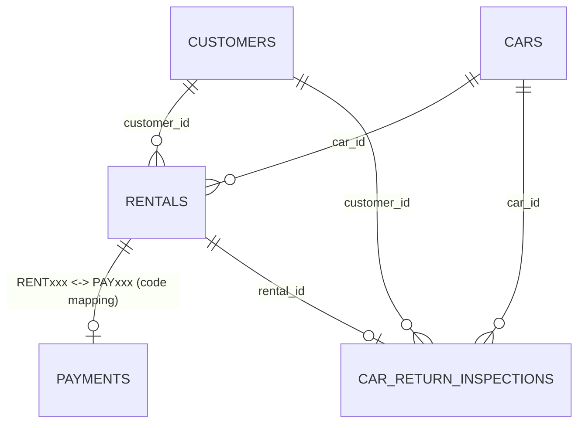

# DB_NOTES

**ระบบ:** ระบบเช่ารถยนต์ (Car Rental System)  
**กลุ่ม:** 8B  
**ขอบเขต:** ตารางและ constraint ที่กระทบ Pain Point 2 (Analytics) และ Pain Point 3 (Rental Actions)

> หมายเหตุสำคัญ: `database_schema.sql` ที่อยู่ใน source เป็น **schema snapshot รุ่นเก่า** บางจุดไม่ตรงกับ PHP ปัจจุบัน เช่น PHP ใช้ `RENTxxx`, `PAYxxx`, `total_price`, `Booked`, `Completed` แต่ schema snapshot ยังประกาศ `rental_id/payment_id` เป็น INT และ status ของ rentals เพียง `Rented/Returned` ดังนั้นไฟล์นี้บันทึกทั้ง “สิ่งที่ schema ระบุ” และ “constraint ที่ code ปัจจุบันบังคับใช้” โดยไม่แก้หรือเดา schema จริง.

## Field / Constraint ที่กระทบ UI

| # | Field | ชนิด/รูปแบบที่พบ | Constraint ที่ตรวจพบ | แสดงบน UI ที่ไหน | Error / State ที่ต้องมี | Rule |
|---|---|---|---|---|---|---|
| 1 | `rentals.rental_id` | Code ใช้รูปแบบ `RENTxxx`; schema snapshot ระบุ INT | ต้องระบุรายการได้แบบไม่กำกวม; delete ใช้ id เป็น key | ตารางการเช่า, Modal ลบ | Modal ต้องแสดงรหัสจริงก่อนยืนยัน; ห้ามลบถ้าไม่มี id | **R-05** |
| 2 | `rentals.status` | Code รองรับ `Booked`, `Rented`, `Completed`, `Returned`; schema snapshot ระบุ `Rented/Returned` | analytics whitelist สถานะ; ตรวจรถคืนใช้เฉพาะ `Completed/Returned` | Filter วิเคราะห์, Badge, Action Menu | สถานะที่ไม่ใช่คืนแล้วต้องไม่เปิด route ตรวจรถคืน | **R-02, R-04** |
| 3 | `rentals.return_date` | DATE | `updateRental()` ห้าม return_date ก่อน rental_date | ตารางการเช่า/ข้อมูลประกอบ action | ไม่เปลี่ยน validation เดิม; Action Menu ต้องไม่แก้วันคืน | **R-04** |
| 4 | `rentals.total_price` | Code ใช้ DECIMAL/number; ไม่ปรากฏใน schema snapshot | คำนวณจากจำนวนวัน x `cars.daily_rate`; analytics SUM ค่า field นี้ | ตารางการเช่า, Summary/Analytics | ห้าม AI คำนวณใหม่ใน frontend หรือแก้ query aggregate | **R-02, R-03** |
| 5 | `payments.payment_id` | Code ใช้ `PAYxxx`; schema snapshot ระบุ INT | mapping 1:1 โดย `PAY` + suffix ของ `RENT` | Analytics join / ผลกระทบตอนลบ | ลบ rental จะเรียก `deletePaymentByRentalId()` ก่อน | **R-05** |
| 6 | `payments.payment_type` | ENUM ที่ schema ระบุ Cash/Credit Card/Bank Transfer/QR Payment | analytics whitelist 4 ค่า + `all` | Filter ช่องทางชำระ | แสดงเฉพาะค่าที่ระบบรองรับ; ค่าอื่น fallback เป็น all | **R-02** |
| 7 | `customers.customer_id` | schema snapshot INT; codeใช้เป็น identifier ใน filter/join | ต้องมีใน customers; analytics ตรวจค่ากับรายการ customer ที่โหลดจริง | Topic ลูกค้า / ตารางผลวิเคราะห์ | ค่าไม่อยู่ในรายการให้ fallback เป็น all | **R-01, R-02** |
| 8 | `cars.status` | ENUM `Available/Rented/Maintenance` | เมื่อลบ rental, code เปลี่ยนรถเป็น Available ยกเว้น Maintenance | ผลข้างเคียงของ Delete | Modal ควรเตือนว่าการลบมีผลต่อข้อมูลที่เชื่อมโยง; business logic เดิมห้ามแก้ | **R-05** |
| 9 | `car_return_inspections.rental_id` | VARCHAR(10), UNIQUE ใน patch | FK -> rentals, `ON DELETE CASCADE` ใน patch | เมนูตรวจรถคืน | การลบ rental อาจลบ inspection ที่เชื่อมโยงตาม DB constraint | **R-04, R-05** |

## ERD ย่อเฉพาะส่วนที่เกี่ยวข้อง

## Constraint ที่ต้องให้มนุษย์ตัดสินก่อนแก้โค้ด

- ความไม่ตรงกันระหว่าง schema snapshot กับ PHP ปัจจุบัน **ไม่อนุญาตให้ AI แก้ schema เอง**.
- Dry-run #2B จะเปลี่ยนเฉพาะ UI ของ Rental Actions; ไม่เปลี่ยน `deleteRental()` หรือ FK.
- ในหน้าวิเคราะห์ การเปลี่ยน interaction ต้องคงชื่อ GET parameter และ SQL semantics เดิมทั้งหมด.
